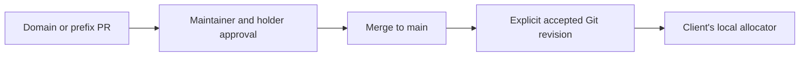

# meridian-registry

Public Meridian domain registry and optional domain-holder prefix registry.

Meridian EUIDs have the form `DOMAIN-PREFIX-BODYCHECKSUM`. This repository records
domain assignments and can host a holder's prefix assignments. The domain holder
still decides who may use its prefixes.

**Request a domain or prefix by opening a pull request targeting `main`.**
This includes reserved domains and prefixes. A grant takes effect only when
the responsible authority approves it and the PR merges. An issue, local file,
branch, release tag, or open PR is not an assignment.

This is JSON in Git plus small Python tools: no server, database, bot, or
network call for each identifier. See [Contributing](CONTRIBUTING.md) and the
[prefix guide](docs/prefix-registries.md).



Registry data is governance metadata. Software must not infer object type, workflow behavior, clinical meaning, business logic, or regulatory status from domain or prefix strings.

## Domain Codes

Domain codes follow the Meridian source specification:

- Length: 1-4 characters
- Alphabet: `0123456789ABCDEFGHJKMNPQRSTVWXYZ`
- Forbidden characters: `I`, `L`, `O`, `U`
- Lowercase, whitespace, non-ASCII input, trimming, and character substitution are rejected

## Files

Source records live in `registry/domains/<DOMAIN>.json`.

Prefix source records live in `registry/prefixes/<DOMAIN>/<PREFIX>.json`.
Generated outputs are `registry/generated/domains.json` and
`registry/generated/prefix_ownership.json`. Build both from source records:

```bash
python tools/build_index.py --stable
```

## Check Availability

Install development dependencies, then run:

```bash
python -m pip install -r requirements-dev.txt
python tools/check_domain.py Q
python tools/check_domain.py D
```

Exit codes:

- `0`: valid and available
- `1`: valid but unavailable
- `2`: invalid input or registry error

## Current Bootstrap Records

| Domain | Status | Holder or purpose |
|---|---|---|
| `A` | reserved | Registry-reserved; not assigned for issuance in the Meridian source |
| `D` | assigned | Daylily Informatics |
| `F` | reserved | Inflection |
| `M` | reserved | LSMC |
| `N` | assigned | Inflection |
| `W` | reserved | Testing/examples |
| `X` | reserved | Testing/examples |
| `Y` | reserved | Testing/examples |
| `Z` | reserved | Testing/examples/development/documentation fixtures |

The inspected Meridian source reserves `F` for Inflection and listed `N` for LSMC. The registry record for `N` follows the explicit 2026-06-04 user correction that `N` is for Inflection.

## Claim A Public Domain

Open a PR **to `main`** adding one JSON record under `registry/domains/`.
Explain the public holder label and requested assignment. Reserved domains
require approval from the reservation authority or named holder; a request
does not override the reservation. Issues are for discussion only.

First valid approved claim wins, subject to maintainer review for abuse, confusing claims, squatting, or bad-faith submissions.

## Private Claims

A private claim may publish only an assigned status and pseudonymous holder reference. Do not commit private identity mappings, raw emails, phone numbers, or postal addresses to this repository.

See `docs/private-claims.md`.

## Prefix Registries

Prefix registries are optional and controlled by the domain holder. A holder
may use this repository's four-field prefix records or explicitly declare its
own public/private registry. Hosted assignments require holder approval in a
PR to `main`; hosting files does not transfer the holder's authority.

The prefix directory starts without imported client claims. Existing private
assignments are not changed or automatically copied here. An absent record
does not establish absence of a prior grant outside this registry.

See `docs/prefix-registries.md`.

## Validate Locally

```bash
python -m pip install -r requirements-dev.txt
python tools/build_index.py --stable
python tools/validate_registry.py
python -m pytest
git diff --exit-code
```
